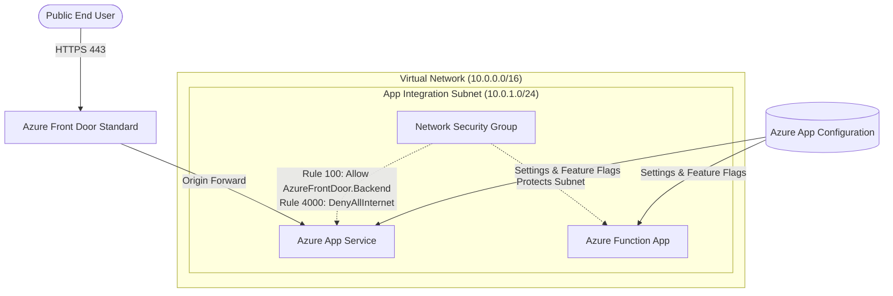

# Assignment 04: Production PaaS Architecture & Networking Fundamentals

## 📖 Scenario & Background
In enterprise cloud engineering, applications are almost never deployed as standalone, isolated public resources. Production workloads require:
1. **Network Boundary Protection**: Subnets and Network Security Groups (NSGs) that dictate exactly which traffic flows in and out.
2. **Global Edge Ingress**: A global load balancer and CDN like **Azure Front Door** sitting at the perimeter of the cloud, routing traffic securely to backend services.
3. **PaaS Compute Cohesion**: An **App Service** (web frontend/API) and an **Azure Function App** (background worker / event processing) sharing an App Service Plan and securely integrated into private subnets.
4. **Centralized Configuration**: **Azure App Configuration** holding shared application keys, feature flags, and settings across environments without hardcoding secrets or app settings.
5. **Multi-Environment Promotion**: The exact same infrastructure code deployed to `dev` (cost-optimized, lower SKUs) and `prod` (high-availability, premium SKUs) using native Bicep parameter files (`.bicepparam`).

This assignment solidifies your understanding of fundamental networking concepts—**Subnet Masks, CIDR Notation, Azure Reserved IPs, and NSGs**—while building an enterprise-grade PaaS foundation.

---

## 🏗️ Architecture Overview



---

## 🧠 Fundamental Theory Deep-Dives

### 1. Subnet Masks, CIDR Notation, & Azure Reserved IPs
When defining cloud networks, you often see notation like `10.0.0.0/16` or `10.0.1.0/24`.

#### What is CIDR and Subnet Mask?
An IPv4 address consists of **32 bits** (4 octets of 8 bits each).
The prefix length (e.g. `/24`) tells you **how many bits represent the network identity**, leaving the remaining bits for **host IP addresses**:

$$\text{Total Host IPs} = 2^{(32 - \text{prefix length})}$$

| CIDR Prefix | Subnet Mask | Total IPs | Usable IPs in Azure | Common Azure Use Case |
|---|---|---|---|---|
| `/16` | `255.255.0.0` | 65,536 | 65,531 | Entire Virtual Network (VNet) address space |
| `/24` | `255.255.255.0` | 256 | **251** | Standard application or compute subnets |
| `/26` | `255.255.255.192` | 64 | **59** | Azure Firewall (`AzureFirewallSubnet` requires $\ge$ /26) |
| `/27` | `255.255.255.224` | 32 | **27** | Azure Bastion or Container Apps environment subnets |
| `/28` | `255.255.255.240` | 16 | **11** | Private Endpoint or Gateway subnets |

#### ⚠️ The 5 IP Addresses Azure Reserves in EVERY Subnet
In traditional on-premises networking, only 2 addresses are reserved (Network ID and Broadcast).
**In Azure, 5 IP addresses are ALWAYS reserved** in every subnet:
- `x.x.x.0`: **Network ID** (identifies the network wire).
- `x.x.x.1`: **Default Gateway** (used by Azure to route traffic out of the subnet).
- `x.x.x.2`: **Azure DNS** (maps to Azure internal DNS resolver).
- `x.x.x.3`: **Azure DNS** (secondary internal mapping).
- `x.x.x.255`: **Broadcast Address** (reserved by Azure networking).

> [!IMPORTANT]
> Because Azure reserves 5 IPs, the smallest possible subnet in Azure is `/29` (8 total IPs − 5 reserved = 3 usable IPs). If you create a `/24` subnet, you have $256 - 5 = 251$ usable IP addresses for your workloads.

#### Subnet Delegation (`Microsoft.Web/serverFarms`)
When integrating PaaS services like Azure App Service or Azure Functions into a VNet (called **Regional VNet Integration**), Azure requires that the subnet is **delegated** exclusively to that service:
```bicep
delegations: [
  {
    name: 'appServiceDelegation'
    properties: {
      serviceName: 'Microsoft.Web/serverFarms'
    }
  }
]
```
Delegation gives Azure the authority to inject private network interfaces directly into your subnet for outbound communication.

---

### 2. Network Security Groups (NSGs) vs Firewalls

#### What is an NSG?
An NSG is a **stateful Layer 4 packet filter** (inspecting Source IP, Source Port, Destination IP, Destination Port, Protocol).
- **Stateful**: If an inbound packet is allowed, return traffic is automatically allowed regardless of outbound rules.
- **Rules & Priorities**: Evaluated from lowest number to highest (100 to 4096). Once a packet matches a rule, evaluation stops!
- **Default Rules (Built-in)**:
  - `AllowVNetInBound` (Priority 65000): Allows all traffic within the VNet.
  - `AllowAzureLoadBalancerInBound` (Priority 65001): Allows Azure health probes.
  - `DenyAllInBound` (Priority 65500): Blocks all other inbound traffic.

#### Service Tags: The Secret Weapon
Instead of hardcoding dynamic IP ranges for Azure services, Azure provides **Service Tags**:
- `Internet`: Any public internet address.
- `VirtualNetwork`: The address space of the VNet, connected VNets, and integrated Azure services.
- `AzureFrontDoor.Backend`: All IP addresses used by Azure Front Door edge POPs to talk to backend origins.

By creating an NSG rule:
- **Priority**: `100`
- **Source**: `AzureFrontDoor.Backend`
- **Destination**: `VirtualNetwork`
- **Port**: `443`
- **Access**: `Allow`

...and then blocking the rest of the public internet, you ensure that malicious attackers cannot bypass Front Door's WAF and hit your application directly!

---

### 3. Azure Portal vs Bicep Comparison Table

Here is how visual operations in the Azure Portal GUI map directly into your Bicep code:

| What you do in Azure Portal | Portal Blade / Setting | Corresponding Bicep Resource & Property |
|---|---|---|
| Create a Virtual Network | **Virtual Networks** > *+ Create* > Basics | `resource vnet 'Microsoft.Network/virtualNetworks@2024-05-01'` |
| Set IPv4 Address Space | VNet > *IP Addresses* > IPv4 Address Space (`10.0.0.0/16`) | `vnet.properties.addressSpace.addressPrefixes: ['10.0.0.0/16']` |
| Add a Subnet & Delegation | VNet > *Subnets* > *+ Subnet* > Subnet delegation: `Microsoft.Web/serverFarms` | `subnets: [ { properties: { addressPrefix: '...', delegations: [...] } } ]` |
| Attach an NSG to Subnet | VNet > *Subnets* > Click Subnet > *Network security group* dropdown | `subnets[0].properties.networkSecurityGroup: { id: nsg.id }` |
| Add Inbound Security Rule | NSG > *Inbound security rules* > *+ Add* > Source: *Service Tag*, Value: `AzureFrontDoor.Backend` | `securityRules: [ { properties: { sourceAddressPrefix: 'AzureFrontDoor.Backend', access: 'Allow' } } ]` |
| Link App Service to Subnet | App Service > *Networking* > *VNet integration* > Select VNet & Subnet | `appService.properties.virtualNetworkSubnetId: subnetRef.id` |
| Add Azure Front Door Endpoint & Origin | Front Door > *Front Door Manager* > *+ Add an origin group* > Select App Service | `Microsoft.Cdn/profiles`, `Microsoft.Cdn/profiles/afdEndpoints`, `originGroups` |
| Read App Config in App Service | App Service > *Configuration* > *App Settings* > Reference App Config endpoint | `appSettings: [ { name: 'APPCONFIG_ENDPOINT', value: appConfig.properties.endpoint } ]` |

---

### 4. Multi-Environment Architecture Pattern (`.bicepparam`)

In enterprise Bicep, you structure code into **reusable modules** driven by environment-specific parameter files:

```
04-production-paas-networking/
├── main.bicep               # Root orchestrator: links modules together
├── dev.bicepparam           # Dev configuration (B1 Basic SKU, dev naming)
├── prod.bicepparam          # Prod configuration (P1v3 Premium SKU, prod naming)
└── modules/
    ├── network.bicep        # VNet, delegated Subnet, and NSG
    ├── appconfig.bicep      # Azure App Configuration store & keys
    ├── compute.bicep        # App Service Plan, Web App & Function App
    └── frontdoor.bicep      # Front Door Profile, Endpoint & Origin Group
```

---

## 🎯 Objectives
You will practice:
1. Writing modular Bicep code with inputs (`param`) and outputs (`output`).
2. Sizing and declaring a Virtual Network with CIDR blocks (`/16`) and delegated subnets (`/24`).
3. Declaring a Network Security Group with stateful priority rules restricting ingress to the `AzureFrontDoor.Backend` Service Tag.
4. Provisioning an Azure App Service Plan, Web App, and Azure Function App with regional VNet integration.
5. Provisioning an Azure App Configuration store and populating key-values.
6. Provisioning an Azure Front Door Profile (Standard) with origin routing to the Web App.
7. Configuring environment files (`dev.bicepparam` and `prod.bicepparam`) to toggle SKUs between environments.

---

## 📝 Tasks

Navigate to the [`starter/`](file:///Users/gautham/workspace/bicep/assignments/04-production-paas-networking/starter) directory and complete each file following the instructions:

### Task 1: Network Module (`modules/network.bicep`)
- Declare parameters for `vnetName`, `vnetAddressPrefix` (default `'10.0.0.0/16'`), `appSubnetName`, `appSubnetPrefix` (default `'10.0.1.0/24'`), and `location`.
- Define an NSG named `${vnetName}-nsg` with:
  - An inbound security rule named `AllowFrontDoorInbound` with Priority `100`, Access `'Allow'`, Direction `'Inbound'`, Protocol `'Tcp'`, Source `'AzureFrontDoor.Backend'`, SourcePortRange `'*'`, DestinationPortRange `'443'`, Destination `'VirtualNetwork'`.
  - An inbound security rule named `DenyAllInternetInbound` with Priority `4000`, Access `'Deny'`, Direction `'Inbound'`, Protocol `'*'`, Source `'Internet'`, Destination `'*'`.
- Define the `Microsoft.Network/virtualNetworks` resource referencing the NSG and adding a subnet delegation for `Microsoft.Web/serverFarms`.
- Output `vnetId`, `appSubnetId`, and `nsgId`.

### Task 2: App Configuration Module (`modules/appconfig.bicep`)
- Declare parameters for `appConfigName`, `sku` (default `'standard'`), and `location`.
- Define a `Microsoft.AppConfiguration/configurationStores` resource.
- Add sample key-value settings using the child resource `Microsoft.AppConfiguration/configurationStores/keyValues`:
  - Key `'Settings:Environment'` with the current environment string.
  - Key `'Features:EnableNewCheckout'` with value `'false'` or `'true'`.
- Output `appConfigEndpoint` and `appConfigId`.

### Task 3: Compute Module (`modules/compute.bicep`)
- Provision an App Service Plan (`Microsoft.Web/serverfarms`) parameterized with `skuName` (e.g. `'B1'` for dev, `'P1v3'` for prod).
- Provision a Web App (`Microsoft.Web/sites`) linked to the App Service Plan and configured with `virtualNetworkSubnetId` pointing to the delegated subnet.
- Configure App Settings on the Web App to ingest the App Configuration endpoint (`APPCONFIG_ENDPOINT`).
- Provision a Function App (`Microsoft.Web/sites` with `kind: 'functionapp'`) sharing the plan and subnet.
- Output `webAppDefaultHostName` and `webAppId`.

### Task 4: Front Door Module (`modules/frontdoor.bicep`)
- Provision an Azure Front Door profile (`Microsoft.Cdn/profiles` with `sku: { name: 'Standard_AzureFrontDoor' }`).
- Define an endpoint (`Microsoft.Cdn/profiles/afdEndpoints`).
- Define an Origin Group (`Microsoft.Cdn/profiles/originGroups`) pointing to the Web App host name.
- Define a Route (`Microsoft.Cdn/profiles/afdEndpoints/routes`) forwarding HTTPS traffic from Front Door to the origin group.
- Output the Front Door endpoint hostname.

### Task 5: Root Orchestrator (`main.bicep`)
- Pull all 4 modules together using Bicep's `module` syntax:
  ```bicep
  module network 'modules/network.bicep' = { ... }
  module appConfig 'modules/appconfig.bicep' = { ... }
  module compute 'modules/compute.bicep' = { ... }
  module frontDoor 'modules/frontdoor.bicep' = { ... }
  ```
- Wire the outputs of `network` into `compute`, and the output of `compute` into `frontDoor`.

### Task 6: Multi-Environment Parameter Files
- In `dev.bicepparam`, specify:
  - `environment: 'dev'`
  - `appServicePlanSku: 'B1'`
  - `vnetAddressPrefix: '10.10.0.0/16'`
  - `appSubnetPrefix: '10.10.1.0/24'`
- In `prod.bicepparam`, specify:
  - `environment: 'prod'`
  - `appServicePlanSku: 'P1v3'`
  - `vnetAddressPrefix: '10.20.0.0/16'`
  - `appSubnetPrefix: '10.20.1.0/24'`

---

## 🔍 Self-Verification Checklist
- [ ] Subnet mask CIDR arithmetic: Verify that the subnet CIDR (e.g. `10.10.1.0/24`) falls within the VNet address space (`10.10.0.0/16`).
- [ ] Subnet delegation: The subnet definition contains `delegations: [{ properties: { serviceName: 'Microsoft.Web/serverFarms' } }]`.
- [ ] NSG rule priorities: Front Door allow rule has lower number (higher priority e.g. 100) than deny rule (e.g. 4000).
- [ ] Service Tag correctness: Inbound source is set to `'AzureFrontDoor.Backend'`.
- [ ] Cross-module dependencies: `compute` module depends on `network.outputs.appSubnetId`.
- [ ] Bicep compilation check: Run `bicep build main.bicep` (or via VS Code Bicep extension) with **0 errors and 0 warnings**.
- [ ] Reference solution comparison: Check your code against [`solution/`](file:///Users/gautham/workspace/bicep/assignments/04-production-paas-networking/solution).
