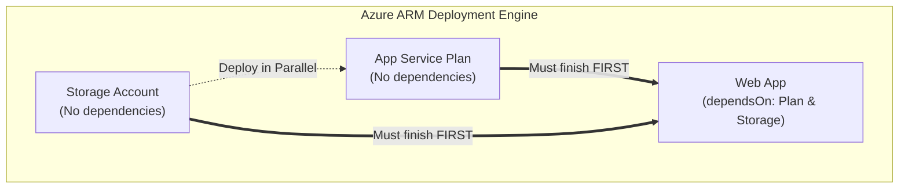

# Assignment 05: Understanding ARM Templates (JSON)

## 📖 Scenario & Background
Before Bicep was released in 2020, all infrastructure-as-code in Azure was written directly in **Azure Resource Manager (ARM) JSON templates**.

Even today, **Bicep is actually an abstraction over ARM templates**:
- When you run `bicep build`, the Bicep compiler transpiles your clean `.bicep` code directly into an ARM JSON template.
- When Azure Resource Manager receives your deployment, **it always executes ARM JSON under the hood**.
- When you click **"Export template"** in the Azure Portal, inspect historical CI/CD deployment logs, or work on enterprise codebases created before 2021, you will encounter raw ARM JSON.

To be an effective Azure engineer, you need to understand how the foundational ARM JSON template works—specifically how **Resource Blocks**, **API Versions**, and **`dependsOn` dependencies** function.

---

## 🏛️ Anatomy of an ARM Template

An ARM template is a single JSON document containing 6 top-level sections:

```json
{
  "$schema": "https://schema.management.azure.com/schemas/2019-04-01/deploymentTemplate.json#",
  "contentVersion": "1.0.0.0",
  "parameters": { ... },
  "variables": { ... },
  "resources": [ ... ],
  "outputs": { ... }
}
```

| Section | Purpose | Bicep Equivalent |
|---|---|---|
| `$schema` | Tells editors and Azure where to find the JSON validation schema | Handled automatically by Bicep compiler |
| `contentVersion` | Version of your template (e.g., `1.0.0.0`) | Not needed in Bicep |
| `parameters` | Values passed in from outside at deployment time | `param name type` |
| `variables` | Values computed inside the template for reuse | `var name = ...` |
| `resources` | The array of Azure resources to create or update | `resource name 'type@version' = { ... }` |
| `outputs` | Values returned after the deployment finishes | `output name type = ...` |

---

## 🧠 Fundamental Theory Deep-Dives

### 1. The Resource Block Anatomy
In ARM JSON, `resources` is an **array of objects**. Each resource object has a strict structural contract:

```json
{
  "type": "Microsoft.Web/serverfarms",
  "apiVersion": "2024-04-01",
  "name": "[parameters('appServicePlanName')]",
  "location": "[parameters('location')]",
  "sku": {
    "name": "B1"
  },
  "properties": {
    "reserved": false
  }
}
```

* **`type`**: The Azure Resource Provider and resource type (e.g., `Microsoft.Web/serverfarms`, `Microsoft.Storage/storageAccounts`, `Microsoft.Web/sites`).
* **`apiVersion`**: The specific version of the REST API that Azure uses to validate and deploy this resource.
* **`name`**: The name of the resource instance.
* **`location`**: The Azure region (e.g., `eastus`, `westeurope`).
* **`sku`**: The pricing tier and capacity (if applicable to the resource).
* **`properties`**: The resource-specific configuration payload.

---

### 2. What is `apiVersion` and Why Does It Matter?
Every service in Azure (Storage, Web, Networking) is managed by an independent **Resource Provider (RP)** (like `Microsoft.Storage` or `Microsoft.Web`).
Each Resource Provider continuously releases new features and changes to their REST APIs, identified by a **date stamp**:

- Format: `YYYY-MM-DD` (Stable version, e.g., `2024-04-01`)
- Format: `YYYY-MM-DD-preview` (Preview version with bleeding-edge features, e.g., `2024-04-01-preview`)

#### Why is `apiVersion` mandatory?
1. **Schema Validation**: Azure uses the `apiVersion` to determine which properties are valid. If you use a property introduced in 2024 with a 2018 `apiVersion`, Azure will reject the deployment with an error.
2. **Preventing Breaking Changes**: If Azure updates the default behavior of App Service in 2025, your 2024 template will not break because your template explicitly pins `apiVersion: "2024-04-01"`.
3. **Immutability**: Once an API version is published by Microsoft, its schema is frozen and supported for years.

---

### 3. `dependsOn`: How Azure Builds the Dependency Graph



#### The Default: Parallel Execution
Azure Resource Manager deploys all resources in the `resources` array **simultaneously in parallel** to maximize deployment speed.

#### The Problem: Race Conditions!
If your Web App needs an App Service Plan to host it, and both are submitted at the same time:
* Azure begins creating the Web App before the App Service Plan exists.
* The deployment crashes immediately with:
  `Code: ResourceNotFound - The Resource 'Microsoft.Web/serverfarms/myPlan' was not found.`

#### The Solution: `dependsOn`
The `dependsOn` property is an array of resource IDs that tell ARM: *"Do not start deploying this resource until every resource in this list has finished successfully."*

In ARM JSON, you construct resource IDs using the `[resourceId()]` function:
```json
"dependsOn": [
  "[resourceId('Microsoft.Web/serverfarms', parameters('appServicePlanName'))]",
  "[resourceId('Microsoft.Storage/storageAccounts', variables('storageAccountName'))]"
]
```

#### 💡 Bicep vs ARM JSON Dependency Magic
* In **ARM JSON**, you **must manually maintain** the `dependsOn` array. If you forget to add a dependency, your deployment will fail randomly depending on which resource finishes first!
* In **Bicep**, whenever you write `serverFarmId: appServicePlan.id`, Bicep's compiler analyzes your code and **automatically generates the `dependsOn` array in the compiled ARM JSON**.

---

### 4. ARM Expression Syntax: The `[...]` Bracket Notation
In JSON, everything is a static string, number, or object. To execute logic, ARM uses square brackets `[...]` inside strings:

| ARM JSON Function | What it does | Bicep Equivalent |
|---|---|---|
| `[parameters('env')]` | Reads a parameter value | `env` |
| `[variables('planName')]` | Reads a variable value | `planName` |
| `[concat('app-', parameters('env'))]` | Joins strings together | `'app-${env}'` |
| `[resourceId('Microsoft.Web/serverfarms', 'myPlan')]` | Generates the fully-qualified Azure Resource ID | `appPlan.id` |
| `[uniqueString(resourceGroup().id)]` | Generates a deterministic 13-character hash | `uniqueString(resourceGroup().id)` |
| `[reference(resourceId('...')).primaryEndpoints.blob]` | Queries runtime properties of another resource | `storage.properties.primaryEndpoints.blob` |

---

## 🔄 The Rosetta Stone: Bicep vs. ARM JSON

### App Service Plan Definition

#### In Bicep:
```bicep
param planName string
param location string = resourceGroup().location

resource appServicePlan 'Microsoft.Web/serverfarms@2024-04-01' = {
  name: planName
  location: location
  sku: {
    name: 'B1'
  }
}
```

#### In ARM JSON:
```json
{
  "$schema": "https://schema.management.azure.com/schemas/2019-04-01/deploymentTemplate.json#",
  "contentVersion": "1.0.0.0",
  "parameters": {
    "planName": {
      "type": "string"
    },
    "location": {
      "type": "string",
      "defaultValue": "[resourceGroup().location]"
    }
  },
  "resources": [
    {
      "type": "Microsoft.Web/serverfarms",
      "apiVersion": "2024-04-01",
      "name": "[parameters('planName')]",
      "location": "[parameters('location')]",
      "sku": {
        "name": "B1"
      }
    }
  ]
}
```

---

## 🎯 Objectives
In this assignment, you will:
1. Understand the structural sections of an ARM template JSON document.
2. Manually write resource blocks for `Microsoft.Storage/storageAccounts`, `Microsoft.Web/serverfarms`, and `Microsoft.Web/sites`.
3. Correctly specify `apiVersion` for each resource provider.
4. Construct explicit `dependsOn` dependencies using the `[resourceId()]` expression function.
5. Reference parameters and variables using `[parameters('...')]` and `[variables('...')]`.

---

## 📝 Tasks

Open [`starter/template.json`](file:///Users/gautham/workspace/bicep/assignments/05-understanding-arm-templates/starter/template.json) and implement the `resources` array according to the instructions below:

### Task 1: Storage Account Resource Block
Add a resource block for an Azure Storage Account:
- **`type`**: `"Microsoft.Storage/storageAccounts"`
- **`apiVersion`**: `"2023-05-01"`
- **`name`**: `"[variables('storageAccountName')]"`
- **`location`**: `"[parameters('location')]"`
- **`sku`**: Object with `"name": "Standard_LRS"`
- **`kind`**: `"StorageV2"`
- **Dependencies**: None (`dependsOn` not needed).

### Task 2: App Service Plan Resource Block
Add a resource block for an App Service Plan:
- **`type`**: `"Microsoft.Web/serverfarms"`
- **`apiVersion`**: `"2024-04-01"`
- **`name`**: `"[variables('appServicePlanName')]"`
- **`location`**: `"[parameters('location')]"`
- **`sku`**: Object with `"name": "[parameters('skuName')]"`
- **Dependencies**: None (`dependsOn` not needed).

### Task 3: Web App Resource Block with `dependsOn`
Add a resource block for the Web App:
- **`type`**: `"Microsoft.Web/sites"`
- **`apiVersion`**: `"2024-04-01"`
- **`name`**: `"[variables('webAppName')]"`
- **`location`**: `"[parameters('location')]"`
- **`dependsOn`**: An array containing TWO resource IDs:
  1. `"[resourceId('Microsoft.Web/serverfarms', variables('appServicePlanName'))]"`
  2. `"[resourceId('Microsoft.Storage/storageAccounts', variables('storageAccountName'))]"`
- **`properties`**:
  - `"serverFarmId"`: `"[resourceId('Microsoft.Web/serverfarms', variables('appServicePlanName'))]"`
  - `"httpsOnly"`: `true`
  - `"siteConfig"`:
    - `"appSettings"`: Array with an object:
      - `"name"`: `"STORAGE_BLOB_ENDPOINT"`
      - `"value"`: `"[reference(resourceId('Microsoft.Storage/storageAccounts', variables('storageAccountName')), '2023-05-01').primaryEndpoints.blob]"`

### Task 4: Template Outputs
In the `outputs` section of `template.json`:
- Output `"webAppUrl"` with type `"string"` and value `"[concat('https://', reference(resourceId('Microsoft.Web/sites', variables('webAppName')), '2024-04-01').defaultHostName)]"`.
- Output `"storageAccountId"` with type `"string"` and value `"[resourceId('Microsoft.Storage/storageAccounts', variables('storageAccountName'))]"`.

---

## 🔍 Self-Verification Checklist
- [ ] Valid JSON: File has no trailing commas or missing closing brackets/braces.
- [ ] Resource Types: Correct casing (`Microsoft.Storage/storageAccounts`, `Microsoft.Web/serverfarms`, `Microsoft.Web/sites`).
- [ ] API Versions: Correct format (`YYYY-MM-DD`).
- [ ] Expression syntax: All expressions are enclosed in quotes and brackets, e.g. `"[parameters('location')]"` and NOT `parameters('location')`.
- [ ] `dependsOn` array: Contains both the App Service Plan and Storage Account resource IDs.
- [ ] Reference solution comparison: Check your finished code against [`solution/template.json`](file:///Users/gautham/workspace/bicep/assignments/05-understanding-arm-templates/solution/template.json).
