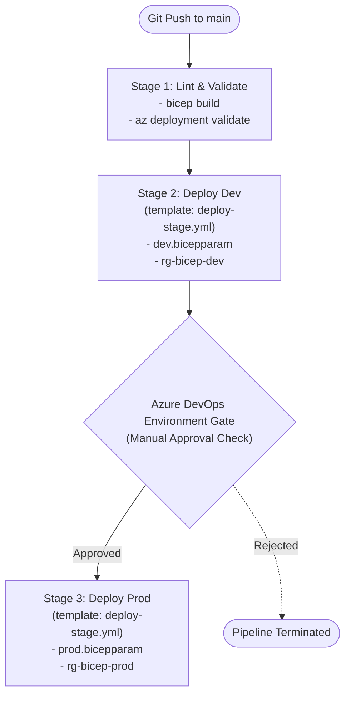

# Assignment 06: Multi-Stage Azure DevOps CI/CD Pipeline

## 📖 Scenario & Background
In modern cloud engineering, infrastructure is never deployed manually by clicking buttons in the Azure Portal. Instead, **continuous delivery pipelines** automate the testing, validation, and rollout of your Bicep templates.

However, real organizations face two critical requirements:
1. **Multi-Environment Promotion**: Infrastructure must be deployed sequentially—first to `Dev` (for automated testing), and only after verification promoted to `Prod`.
2. **DRY (Don't Repeat Yourself) Pipeline Architecture**: If you copy-paste 100 lines of pipeline YAML for every environment (`dev`, `qa`, `stage`, `prod`), your pipeline quickly becomes impossible to maintain.

In Azure DevOps Pipelines, the enterprise standard is the **YAML Template Pattern**:
- A single reusable **stage template** (`templates/deploy-stage.yml`) encapsulates the deployment steps.
- The root pipeline (`azure-pipelines.yml`) orchestrates the stages (`Validate` $\to$ `Dev` $\to$ `Prod`), passing environment-specific parameters (`bicepparamFile`, `resourceGroupName`, `serviceConnection`).

---

## 🏗️ Pipeline Flow Architecture



---

## 🧠 Fundamental Theory Deep-Dives

### 1. Multi-Stage Pipeline Anatomy in Azure DevOps
An Azure DevOps YAML pipeline is organized hierarchically:

```
Pipeline
 └── Stages (e.g., Lint, Dev, Prod)
      └── Jobs (e.g., Agent job or Deployment job)
           └── Steps (e.g., checkout, bash scripts, Azure tasks)
```

- **`trigger`**: Dictates when the pipeline runs (e.g., automatically on commits to `main`).
- **`stages`**: Logical boundaries representing environments or lifecycle phases. By default, stages run in parallel unless you specify `dependsOn`.
- **`jobs`**: Units of execution that run on a build agent (e.g., `vmImage: 'ubuntu-latest'`).
- **`deployment` job**: A specialized job type in Azure DevOps designed for CD. It records history against an **Azure DevOps Environment** and triggers automated health checks, approvals, or gates.

---

### 2. The Reusable Template Pattern (DRY)
Instead of repeating deployment tasks for every environment, Azure DevOps provides **YAML Templates**:

#### Why use templates?
- **Single Source of Truth**: Security policies, what-if checks, and deployment flags are updated in one file (`deploy-stage.yml`).
- **Consistency**: Guarantees that `Prod` is deployed with the exact same process and guardrails as `Dev`.
- **Security & Governance**: Platform teams can enforce required checks (e.g. running `what-if` before deployment) without letting individual developers skip steps.

#### Parameter Passing in Azure DevOps Templates
A template defines input `parameters`:
```yaml
# templates/deploy-stage.yml
parameters:
  - name: environmentName
    type: string
  - name: azureServiceConnection
    type: string
  - name: resourceGroupName
    type: string
  - name: bicepparamFile
    type: string
```

The caller (`azure-pipelines.yml`) passes arguments into the template:
```yaml
# azure-pipelines.yml
- template: templates/deploy-stage.yml
  parameters:
    environmentName: 'dev'
    azureServiceConnection: 'sc-azure-dev'
    resourceGroupName: 'rg-bicep-dev'
    bicepparamFile: 'assignments/04-production-paas-networking/solution/dev.bicepparam'
```

---

### 3. Safe Deployments: What-If & Validation
Production-grade pipelines should never execute `az deployment group create` blindly. They use a two-phase check:

1. **`az deployment group validate`**:
   - Sends the template and parameters to Azure Resource Manager to verify syntax, resource provider quotas, naming constraints, and parameter data types **without deploying anything**.
2. **`az deployment group what-if`**:
   - Compares the desired state in your Bicep file with the current live state of Azure resources.
   - Outputs a color-coded preview of what will be **Created (+)**, **Modified (~)**, or **Deleted (-)**.

```yaml
- task: AzureCLI@2
  displayName: 'Preview Changes (What-If)'
  inputs:
    azureSubscription: ${{ parameters.azureServiceConnection }}
    scriptType: 'bash'
    scriptLocation: 'inlineScript'
    inlineScript: |
      az deployment group what-if \
        --resource-group ${{ parameters.resourceGroupName }} \
        --template-file ${{ parameters.bicepFilePath }} \
        --parameters ${{ parameters.bicepparamFile }}
```

---

### 4. Azure DevOps Environments & Approval Gates
In Azure DevOps, an **Environment** (found under *Pipelines* > *Environments* in the Azure DevOps portal) is a logical target representing a collection of resources (e.g. `production`).

When you use:
```yaml
environment: ${{ parameters.environmentName }}
```
Azure DevOps automatically pauses the pipeline before running the stage if **Approvals and Checks** are configured on that Environment. An authorized team lead or architect must click **Approve** in the UI before deployment to production begins!

---

## 🎯 Objectives
In this assignment, you will:
1. Build a production-grade multi-stage Azure DevOps YAML pipeline (`azure-pipelines.yml`).
2. Implement a reusable stage template (`templates/deploy-stage.yml`) parameterized for any environment.
3. Add a **Validation Stage** that compiles Bicep templates and performs dry-run validation.
4. Add sequential **Dev** and **Prod** deployment stages using `dependsOn` and `condition: succeeded()`.
5. Connect your Assignment 04 modular Bicep templates and `.bicepparam` files into the CI/CD pipeline.

---

## 📝 Tasks

Open the [`starter/`](file:///Users/gautham/workspace/bicep/assignments/06-multi-env-azure-devops-pipeline/starter) folder and complete the pipeline implementation:

### Task 1: Reusable Stage Template (`templates/deploy-stage.yml`)
Define a reusable `stage` in `templates/deploy-stage.yml`:
- Declare parameters:
  - `environmentName` (string)
  - `stageDisplayName` (string)
  - `azureServiceConnection` (string)
  - `resourceGroupName` (string)
  - `location` (string, default `'eastus'`)
  - `bicepFilePath` (string)
  - `bicepparamFile` (string)
  - `dependsOnStages` (type: `object`, default `[]`)
- Configure the stage `dependsOn: ${{ parameters.dependsOnStages }}` and condition `succeeded()`.
- Define a `deployment` job targeting `environment: ${{ parameters.environmentName }}`.
- Add an `AzureCLI@2` task to create the Resource Group if it doesn't already exist:
  ```bash
  az group create --name ${{ parameters.resourceGroupName }} --location ${{ parameters.location }}
  ```
- Add an `AzureCLI@2` task to run `az deployment group what-if`.
- Add an `AzureCLI@2` task to execute the actual deployment:
  ```bash
  az deployment group create \
    --resource-group ${{ parameters.resourceGroupName }} \
    --template-file ${{ parameters.bicepFilePath }} \
    --parameters ${{ parameters.bicepparamFile }}
  ```

### Task 2: Root Pipeline Orchestrator (`azure-pipelines.yml`)
In `azure-pipelines.yml`:
- Set trigger on branch `main`.
- Define global pipeline variables:
  - `bicepFilePath`: `'assignments/04-production-paas-networking/solution/main.bicep'`
  - `location`: `'eastus'`
- Define **Stage 1 (`Lint_And_Validate`)**:
  - Run on `ubuntu-latest`.
  - Step 1: Run `az bicep build --file $(bicepFilePath)` to ensure the Bicep code compiles without syntax or type errors.
- Define **Stage 2 (`Deploy_Dev`)**:
  - Call `template: templates/deploy-stage.yml`
  - Pass `environmentName: 'development'`
  - Pass `resourceGroupName: 'rg-bicep-app-dev'`
  - Pass `bicepparamFile: 'assignments/04-production-paas-networking/solution/dev.bicepparam'`
  - Pass `dependsOnStages: ['Lint_And_Validate']`
- Define **Stage 3 (`Deploy_Prod`)**: 
  - Call `template: templates/deploy-stage.yml`
  - Pass `environmentName: 'production'`
  - Pass `resourceGroupName: 'rg-bicep-app-prod'`
  - Pass `bicepparamFile: 'assignments/04-production-paas-networking/solution/prod.bicepparam'`
  - Pass `dependsOnStages: ['Deploy_Dev']`

---

## 🔍 Self-Verification Checklist
- [ ] Valid YAML indentation: Standard 2-space indentation throughout.
- [ ] Template Parameter syntax: Parameters referenced using `${{ parameters.paramName }}`.
- [ ] Pipeline Variable syntax: Variables referenced using `$(variableName)`.
- [ ] Dependencies: `Deploy_Dev` depends on `Lint_And_Validate`, and `Deploy_Prod` depends on `Deploy_Dev`.
- [ ] Offline local validation: Run `bicep build` on the referenced Bicep files to verify zero compilation errors.
- [ ] Reference solution comparison: Check your finished pipeline against [`solution/`](file:///Users/gautham/workspace/bicep/assignments/06-multi-env-azure-devops-pipeline/solution).
